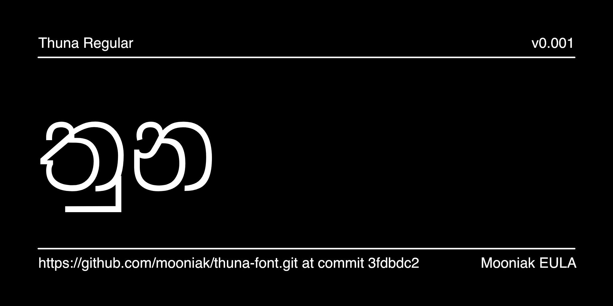

# Thuna Font

Thuna is a Sinhala typeface by Aravinda Illangangedara, maintained by [Mooniak](https://mooniak.com/). It is a free font, published under the SIL Open Font License. It is in an early (alpha) stage.

## About

Thuna started from a FontForge drawing (`sources/1-drawing/Thuna.sfd`, kept for reference); the current outlines come from Akuru Foundry's `AFThuna.ttf` (`sources/1-drawing/AFThuna.ttf`) and a template of letters in `documentation/`. The source is now a Glyphs package, `sources/Thuna.glyphspackage`, with [LankaGlyphset](https://github.com/mooniak/lanka-glyphsets) glyph names (`ka-sinh`, `aasign-sinh`, …) and OpenType features generated for them.

- 540 glyphs, one master (Regular), 1000 units per em.
- Sinhala letters, vowel signs, hal forms, the drawn conjuncts, Sinhala Lith digits and a basic Latin set.
- Alternates for the i / ii / u / uu signs and virama (`ss01`, `ss02`).

What is still to do for this font is tracked centrally with `mnik check thuna`.

## Building

Fonts are built automatically by GitHub Actions - take a look in the "Actions" tab for the latest build.

If you want to build fonts manually on your own computer:

- `make build` will produce font files.
- `make test` will run [FontBakery](https://github.com/googlefonts/fontbakery)'s quality assurance tests.
- `make proof` will generate HTML proof files.

The proof files and QA tests are also available automatically via GitHub Actions.

## Changelog

- 0.001 — Ported to the Mooniak font setup: Glyphs package source, LankaGlyphset glyph names, generated OpenType features, Mooniak metadata and vertical metrics.

## License

This Font Software is licensed under the SIL Open Font License, Version 1.1. This license is
available with a FAQ at https://openfontlicense.org; the full text is in [OFL.txt](OFL.txt).

## Repository Layout

This font repository structure is inspired by [Unified Font Repository v0.3](https://github.com/unified-font-repository/Unified-Font-Repository), modified for the Google Fonts workflow.
